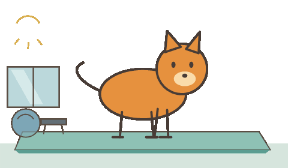

<div align="center">


# PurrCue

A little cat to remind you to drink water, stretch, and take a break.

**English** | [简体中文](README.zh-CN.md) | [日本語](README.ja.md) | [한국어](README.ko.md)

[Download](https://github.com/zzuoing/purr-cue/releases/latest) · [JoyCows](https://joycows.com/) · [Report an issue](https://github.com/zzuoing/purr-cue/issues)



</div>

## Features

- Windows, macOS, and Linux packages; works offline with local reminder storage.
- One-time reminders and reminders repeated on selected weekdays.
- Eight quick states: start work, fresh air, water, food, stretch, walk, toilet, and finish work. Other messages use a general animation.
- Quick states fill the text and immediately interrupt the current animation to play the selected one. Save to schedule a reminder; previewing alone creates none.
- Date/time panel, tray controls, single-instance operation, and four interface languages.

## Download and install

Get packages from the [latest release](https://github.com/zzuoing/purr-cue/releases/latest).

| Platform | Package | Installation |
| --- | --- | --- |
| Windows x64 | `.exe` | Run the installer; choose a language and installation folder. |
| macOS Intel / Apple Silicon | universal `.dmg` / `.zip` | Open the DMG and drag the app to Applications, or extract the ZIP. |
| Linux x64 | `.AppImage` / `.deb` | Make the AppImage executable and run it, or install the deb with your package manager. |

Packages are unsigned; macOS notarization is not configured. macOS behavior still needs real-hardware testing. Linux placement, always-on-top behavior, and tray support can vary by desktop environment and Wayland compositor. Linux login startup is not currently available in the app.

## Use

1. Choose a one-time reminder or repeat mode and weekdays.
2. Click the time field/calendar icon to choose a date and time. Manual `YYYY-MM-DD HH:mm` / `HH:mm` input also works.
3. Enter a message, or click a quick state to preview its animation, then save to schedule it.

Animations appear at the bottom of the primary display's work area. Click the animation or press Esc to dismiss it (Esc must be available as a global shortcut). Closing the settings window keeps reminders running in the tray; use the tray menu to quit.

Reminders are checked every 15 seconds and after waking from sleep. One-time reminders catch up within 24 hours and are removed when dismissed. Repeating reminders use local time, catch up within 6 hours, and run once per selected day. Multiple due reminders are handled on subsequent checks. Interrupting a one-time reminder with a quick animation completes and removes that reminder, leaving others intact.

## Languages

Use the **translation icon beside the language menu** at the bottom. On first launch the app follows your system language; unsupported languages fall back to English. Your choice is saved. Interface, calendar, tray, and reminder keywords support English, Simplified Chinese, Japanese, and Korean; your reminder text is never translated automatically.

The Windows installer has its own four-language selector, initially following Windows with English as the fallback. Installer language and the app's saved language are independent. DMG, ZIP, AppImage, and deb do not have this Windows-style wizard; the app uses the same language rules after launch.

## Local data

`reminders-v2.json` and `settings.json` are stored in the Electron user-data folder. Its name stays `桌面提醒` across languages:

| Platform | Default folder |
| --- | --- |
| Windows | `%APPDATA%/桌面提醒` |
| macOS | `~/Library/Application Support/桌面提醒` |
| Linux | `$XDG_CONFIG_HOME/桌面提醒` (usually `~/.config/桌面提醒`) |

Windows imports `%LOCALAPPDATA%/DesktopReminder/reminders-v2.json` on first use if no new data exists, leaving the original intact. Quit the old app and disable its startup entry yourself. Unreadable files receive a `.broken-<timestamp>` backup; failed saves roll back the edit. Currently there is no account, cloud sync, or telemetry.

## Development

Requires Node.js 24+, npm, and a graphical desktop. Electron may download its runtime on first use.

```sh
npm ci
npm start
npm run check
npm test
npm run verify:app
npm run dist:win
npm run dist:linux
# On macOS:
npm run dist:mac -- --universal --publish never
```

Packages go to `release/`. `npm run preview -- 拉伸` previews without changing reminder data. The original app remains in `legacy/` and is excluded from packages. Animation timing, geometry, and the original stretch GIF are retained; font rendering and antialiasing can differ from GDI+. See [development notes (Chinese)](DEVELOPMENT.md) for animation checks and WSL builds.

## CLI for AI assistants

PurrCue includes a local CLI for adding, listing, and removing reminders. Windows packages include `purrcue.cmd` beside `PurrCue.exe`; run it from that folder or add the folder to PATH. macOS bundles include `PurrCue.app/Contents/purrcue`; extracted Linux packages include `purrcue` beside the app executable. No separate Node installation is needed for bundled launchers. For an AppImage, use `./PurrCue-<version>-linux-x86_64.AppImage --cli <command>`. Run `chmod +x` first where needed.

```sh
purrcue add --in 20m --message "Take a break" --json
purrcue add --at "2026-12-01 14:30" --message "Meeting" --json
purrcue add --time 09:00 --days mon,tue,wed,thu,fri --message "Start work" --json
purrcue list --json
purrcue remove <id> --json
purrcue status --json
```

From source, use `node bin/purrcue.cjs <command>`, or run `npm link` to register `purrcue` in your npm bin directory. `--help` documents all options. Dates without an offset use local time. With `--json`, stdout contains one `{ok,value}` or `{ok:false,error}` object; errors exit with status 1. IDs come from add/list. The CLI starts the app in the tray if needed; use `--no-launch` to disable this or `--data-dir <folder>` for an isolated profile. The app must remain running to deliver reminders.

Commands use an authenticated local named pipe/Unix socket. The app validates and saves changes, updating the UI immediately. There is no HTTP listener or remote API. Keep `cli-connection.json` private; it contains a local access token.

In AppImage extract-and-run mode, the outer runtime can print extraction paths around the CLI response. Use the extracted `purrcue` launcher when an AI tool requires clean JSON stdout.

## Releases

Commit and push the code, then push a version tag such as `v2.0.2`. GitHub Actions validates the tag and sets the package, installer, and displayed version in its build directory. All three builds must pass before publishing a GitHub Release with installers. Tags such as `v2.0.2-beta.1` create prereleases. PR and manual runs upload Actions artifacts without publishing a Release; CI does not commit version changes back to Git.

## License and credits

[MIT](LICENSE) · [Third-party notices](THIRD_PARTY_NOTICES.md).

README organization takes inspiration from [BongoCat](https://github.com/ayangweb/BongoCat). This project retains its own cat animations and reminder behavior; no BongoCat code or artwork is included.
